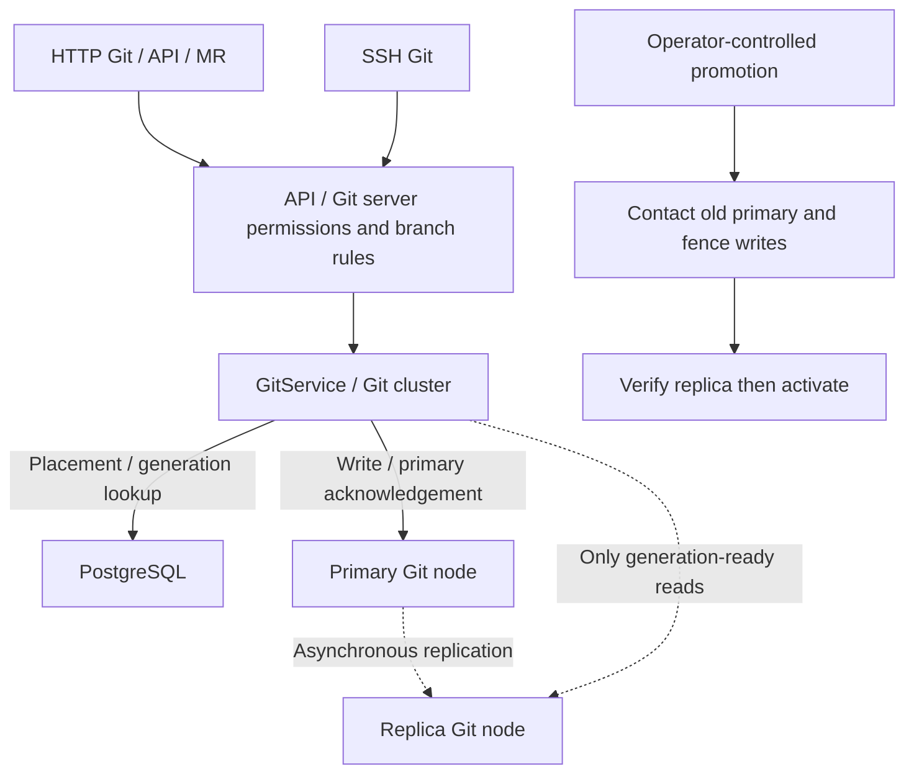
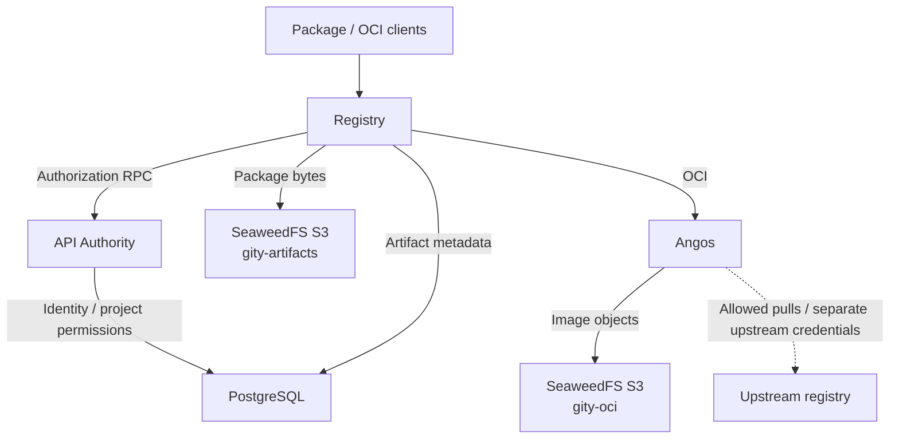
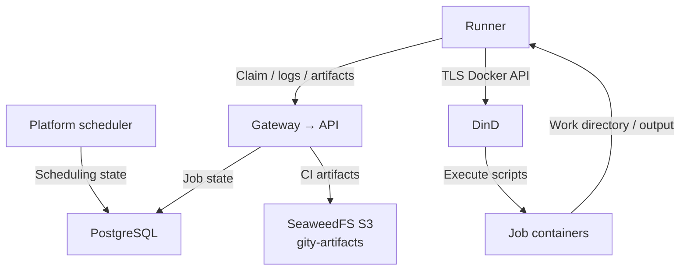

[简体中文](../../zh/architecture/data-flows.md) · [English](data-flows.md)

# Git, artifact, and CI data flows

## Git reads and writes

HTTP Git, API file commits, MR merges, and SSH reach the Git service backend. Product entry points enforce user and branch policy. With a cluster configured, Git cluster queries placement and data generation, then operates Git nodes over internal RPC. The database stores control metadata; bare repositories store Git objects.

The primary confirms writes before asynchronous replication. A replica can serve reads only when it meets the required generation. Pending writes or replica lag must not return stale contents as the latest result. Primary acknowledgement does not guarantee replica durability.

Controlled promotion requires a reachable old primary: fence further writes, verify the target replica, and activate the new primary. An unreachable primary does not automatically cause another node to accept writes. There is no Raft lossless automatic failover.

## Packages, OCI, and CI

The database/S3 boxes show the distributed example; Standalone defaults to SQLite and local object directories.

Package Registry adapts Cargo, npm, PyPI, Maven, NuGet, Go, and Generic protocols. Independent deployment queries API Authority for project permissions. Artifact services persist metadata in PostgreSQL and binary objects in storage. Standalone reuses these services with local authorization and configurable local storage.

OCI requests pass Gity policy and permission checks before reaching Angos. Compose assigns Angos a separate `gity-oci` bucket; packages and CI artifacts use `gity-artifacts`. Mirror upstreams must be configured and allowed. Caller tokens and upstream credentials are separate. An OCI cache is not a Git replica or failover mechanism.

CI validates YAML, schedules jobs, and stores execution state. Runner claims jobs, fetches sources, starts job containers through DinD, and returns logs and artifacts. User scripts execute in the Runner environment, not in platform scheduler tasks.

PostgreSQL and same-named buckets across figures represent shared services. Solid edges show requests or writes; dotted edges identify conditional replica reads, asynchronous replication, or controlled upstream pulls, as labeled.

Sources: [Git backend](https://github.com/lyonbrown4d/gity/tree/main/crates/gity-git-cluster/src), [package services](https://github.com/lyonbrown4d/gity/tree/main/crates/gity-package-registry/src), [OCI gateway](https://github.com/lyonbrown4d/gity/tree/main/crates/gity-oci/src), [Runner](https://github.com/lyonbrown4d/gity/tree/main/apps/gity-runner/src).

## CI execution flow

