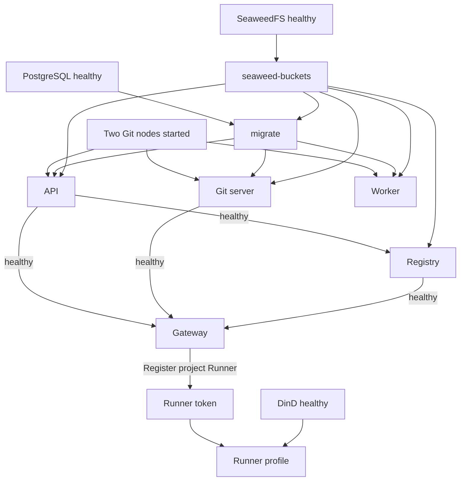

[简体中文](../../zh/architecture/distributed.md) · [English](distributed.md)

# Distributed component startup

The supplied layout runs independent application processes and containers on one Docker host, sharing PostgreSQL and SeaweedFS. Every process has its own FluxDI Application; no DI container is shared across processes.

## Request and data flow

With the current `gateway.toml`, browsers, ordinary APIs, and HTTP Git go through Gateway to API. Package paths go through Gateway to Registry's package listener. SSH is forwarded to Git server. OCI is published directly from Registry, independently of the edge Gateway.

API, Git server, and Worker use the Git cluster backend to reach storage nodes. Registry uses API Authority RPC for authorization and supervises a local Angos process. Platform metadata shares PostgreSQL; binary artifacts use S3. Runner polls the task API and starts job containers through TLS DinD.

## Compose startup dependencies

1. PostgreSQL, SeaweedFS, and the two Git nodes can start first. Git nodes have their own repository volumes and do not depend on the database.
2. After SeaweedFS becomes healthy, `seaweed-buckets` creates `gity-artifacts` and `gity-oci`. The one-shot `migrate` service waits for database health and successful bucket initialization, applies schema migrations, and exits. The database must be empty; an incompatible existing schema causes migration to fail, and the application does not clear it. See [Database migrations](../database-migrations.md) for upgrade prerequisites.
3. API, Git server, and Worker wait for migration completion, started Git nodes, and the relevant storage dependencies. Git node's condition is `service_started`, not RPC readiness or replica catch-up.
4. Registry waits for API and object storage health. Its process supervises Angos, OCI gateway, and an independent package HTTP module, using API Authority RPC for package/OCI permissions.
5. Gateway waits for the API, Git server, and Registry health checks before exposing HTTP/SSH ingress.
6. The base stack excludes Runner. Register a project Runner first, then enable the `runner` profile with its token. Runner waits for Gateway and DinD health before claiming jobs.

These are dependency conditions, not a strictly serial startup of all nodes. See [Compose operations](../deployment/compose.md) for commands and secret preparation.

## Shared code and application roles

| Role / default command | HTTP | SSH | CI scheduler | Maintenance | Migrations at startup |
| --- | --- | --- | --- | --- | --- |
| Standalone / `standalone` | Yes | When enabled | Yes | Yes | Yes |
| API / `serve` | Yes | No | No | Yes | No |
| Git / `serve` | Yes | When enabled | Yes | Yes | No |
| Worker / `worker` | No | No | Yes | Yes | No |

These are current `ApplicationRole` and `PlatformOptions` defaults. Maintenance includes index refresh and pending artifact cleanup when packages are enabled. Configured Git cluster modules also start replica reconciliation; this task is not exclusive to Worker.

Registry, Gateway, and Git node have their own module composition entry points. Registry packages use a dedicated listener while sharing protocol and artifact implementations with standalone's embedded mode. Each entry point handles shutdown through module lifecycle.

## Identity, storage, and failure boundaries

API, Git server, Worker, and package Registry share the database with writer node IDs `1`, `2`, `3`, and `5`. Every additional writer requires a unique node ID. Search indexes and service working state use process-specific local volumes.

Internal Authority/Git RPC uses TLS, client certificates, and peer credentials. Product services perform user authorization before trusted node operations. Registry fails when Authority is unavailable; Gateway does not maintain a separate authorization cache to bypass API.

Git `replicas = 2` means a primary and one replica. The primary confirms writes before asynchronous replication. Only replicas satisfying data-generation requirements may serve reads. Controlled promotion must contact the old primary to fence writes, verify the replica, and activate it. An unreachable old primary prevents promotion. There is no Raft lossless automatic failover.

Gateway `/readyz` checks local listener task state. It does not prove health of API, the database, Git nodes, or storage. Initial Compose health dependencies do not guarantee automatic recovery from subsequent failures.

Sources: [application roles](https://github.com/lyonbrown4d/gity/blob/main/crates/gity-platform/src/application.rs), [Compose dependencies](https://github.com/lyonbrown4d/gity/blob/main/deploy/components/distributed-components.compose.yaml), [Gateway configuration](https://github.com/lyonbrown4d/gity/blob/main/deploy/components/config/gateway.toml), [Git cluster module](https://github.com/lyonbrown4d/gity/blob/main/crates/gity-git-cluster/src/module.rs).

