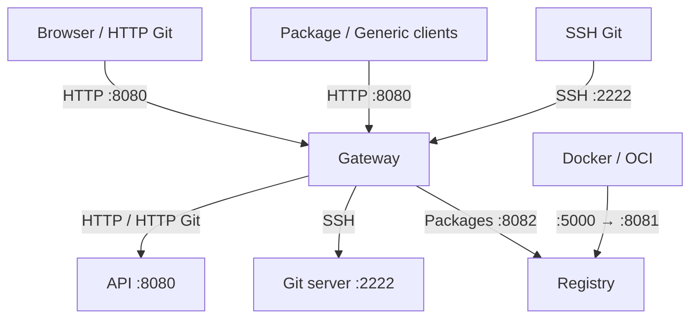

<div lang="en">

[简体中文](../../zh/architecture/overview.md) · [English](overview.md)

# Overall architecture




Gity combines shared Rust business libraries with separately deployable applications. Standalone composes the main modules in one platform process. The distributed layout separates ingress, platform services, Git storage, and artifact protocols into different processes while reusing the same business implementations.

## Code layers

```text
apps/                   Executable entry points and process configuration
  ↓
crates/gity-platform    Platform routes, application composition, collaboration
  ↓
Identity / artifacts / Git domain services and ports
  ↓
SeaORM repositories, local or RPC Git adapters, object storage adapters
```

Applications do not import business implementations from other applications. Shared components belong in `crates/`, database changes in `migrations/`, and build and verification tools in `xtask/`.

The contexts cover identity and access, projects and collaboration, Git, CI, and artifacts. Identity and artifacts have dedicated services and repositories. Organization/project, Issue, MR, and CI implementations are partly concentrated in `gity-platform`. These boundaries do not imply a separate service or database for every context.

## Runtime dependencies

The database holds accounts, permissions, projects, tasks, artifact metadata, and Git placement state. Git objects live in bare repositories. Packages, attachments, and CI artifacts use the storage adapter. The distributed example shares PostgreSQL across platform processes and uses SeaweedFS S3; it does not implement database-per-context isolation.

Web is a Leptos/WASM static bundle served by the platform HTTP service. Monaco and Milkdown ship as local third-party assets. No separate Node application is required to serve Web.

## Shared capabilities

| Capability | Implementation |
| --- | --- |
| Composition | FluxDI registration, resolution, and module lifecycle |
| HTTP / concurrency | Axum and Tokio, with streaming transfer paths |
| Persistence | SeaORM entities, ActiveModels and transactions; some platform repositories use the existing common interface |
| Entity identifiers | Snowflake via `ferroid` (41/10/12 layout); the generator is installed from the unique node ID during assembly and inserts assign IDs in `before_save`; string IDs in public JSON |
| Operation identifiers | UUID v7; cryptographically random secrets |
| Configuration | Code defaults < file < environment < explicit CLI |
| Observability | Tracing, Prometheus and optional OTLP, initialized per process |
| API documentation | Utoipa-generated OpenAPI, `/docs` and `/openapi.json` |
| Localization | Shared `gity-i18n` assets; request-scoped server language |

## Deployment boundaries

Standalone contains all business components by default in its supplied configuration. Runner and Angos remain supervised child processes, and Compose runs DinD separately. A single entry point therefore includes multiple OS processes.

Distributed components have separate binaries and images with explicit dependencies. The supplied Compose layout targets one Docker host. It is not a complete multi-host, highly available, or database-per-service deployment.

See [component responsibilities](components.md), [Standalone startup](standalone.md), and [distributed startup](distributed.md).

Sources: [platform composition](https://github.com/lyonbrown4d/gity/blob/main/crates/gity-platform/src/composition.rs), [application roles](https://github.com/lyonbrown4d/gity/blob/main/crates/gity-platform/src/application.rs), [workspace](https://github.com/lyonbrown4d/gity/blob/main/Cargo.toml).

</div>
