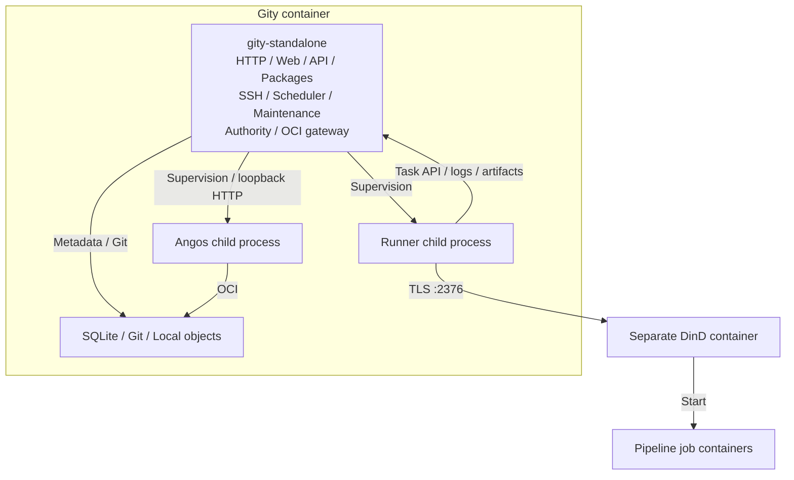

[简体中文](../../zh/architecture/standalone.md) · [English](standalone.md)

# Standalone startup

This chapter describes the supplied `deploy/components/config/standalone.toml` and standalone Compose configuration. It enables all business modules and uses SQLite, local bare repositories, and local object directories.

## Process organization

The platform process runs HTTP, Web, APIs, package protocols, SSH, scheduling, maintenance, authority, and the OCI gateway as asynchronous tasks. It supervises separate Angos and Runner child processes. Runner starts user job containers through the separate TLS-enabled DinD service.

## From configuration to listeners

1. `apps/gity-standalone` invokes `application::run(Standalone)`. Clap parses arguments, configuration is loaded and validated, and logging, metrics, and optional tracing initialize.
2. `composition::compose` creates database and storage adapters. `RuntimeModule` resolves identity, Git backend, search, and `AppState`; packages add the artifact service. Without Git cluster configuration, the local Git backend is selected.
3. The default command is `standalone`, which applies Rust schema migrations before component startup. The database must be empty; an incompatible existing schema or migration history causes startup to fail. Startup never clears the database or converts the old migration history. Invalid configuration, migration, or dependency construction aborts startup. See [Database migrations](../database-migrations.md) for upgrade prerequisites.
4. Composition registers enabled Angos, Platform, Authority, OCI gateway, and Runner modules. `PlatformModule` imports the embedded package module and optional Git cluster module.
5. `fluxdi::Application::bootstrap()` invokes module lifecycle hooks. Platform binds HTTP/SSH listeners before starting servers, scheduling, and maintenance tasks. Embedded packages reuse platform HTTP routes instead of opening port `8082`.
6. Runner module launches `gity-runner`, pointing at the loopback platform API, private project token directory, and configured container engine. Project Runner registration supplies credentials for local job claiming.

Modules share platform database/storage state and the process's unified ID generator. Standalone does not allocate a separate Snowflake node ID per module.

## Supervision and shutdown

Unexpected termination of HTTP, SSH, scheduling, or maintenance tasks triggers shutdown. Periodic checks also monitor Runner, Authority, OCI gateway, and Angos lifecycle handles. Exhausting the Angos restart policy causes the application to exit.

SIGTERM or Ctrl-C invokes `Application::shutdown()`. Modules cancel tasks, close listeners, and reap child processes. Runner first receives SIGTERM; a timeout leads to forced termination. These checks monitor process/task state, not continuous health of every database, storage, and business operation.

## Compose organization

Compose starts DinD and waits for its health check before starting Gity. Public ports default to HTTP `8080`, SSH `2222`, and OCI `5000`. Authority `9100` and Angos `18000` bind to container loopback.

`gity-data` persists platform state. DinD has separate data and certificate volumes. The same absolute Runner work path is mounted into Gity and DinD so job containers can access sources. DinD requires privileged mode and a host dedicated to trusted container workloads.

Commands and secret preparation are maintained in [Compose operations](../deployment/compose.md).

Sources: [Standalone entry point](https://github.com/lyonbrown4d/gity/blob/main/apps/gity-standalone/src/main.rs), [module composition](https://github.com/lyonbrown4d/gity/blob/main/crates/gity-platform/src/standalone/mod.rs), [Platform lifecycle](https://github.com/lyonbrown4d/gity/blob/main/crates/gity-platform/src/lifecycle/mod.rs), [Runner lifecycle](https://github.com/lyonbrown4d/gity/blob/main/crates/gity-platform/src/standalone/runner.rs).

