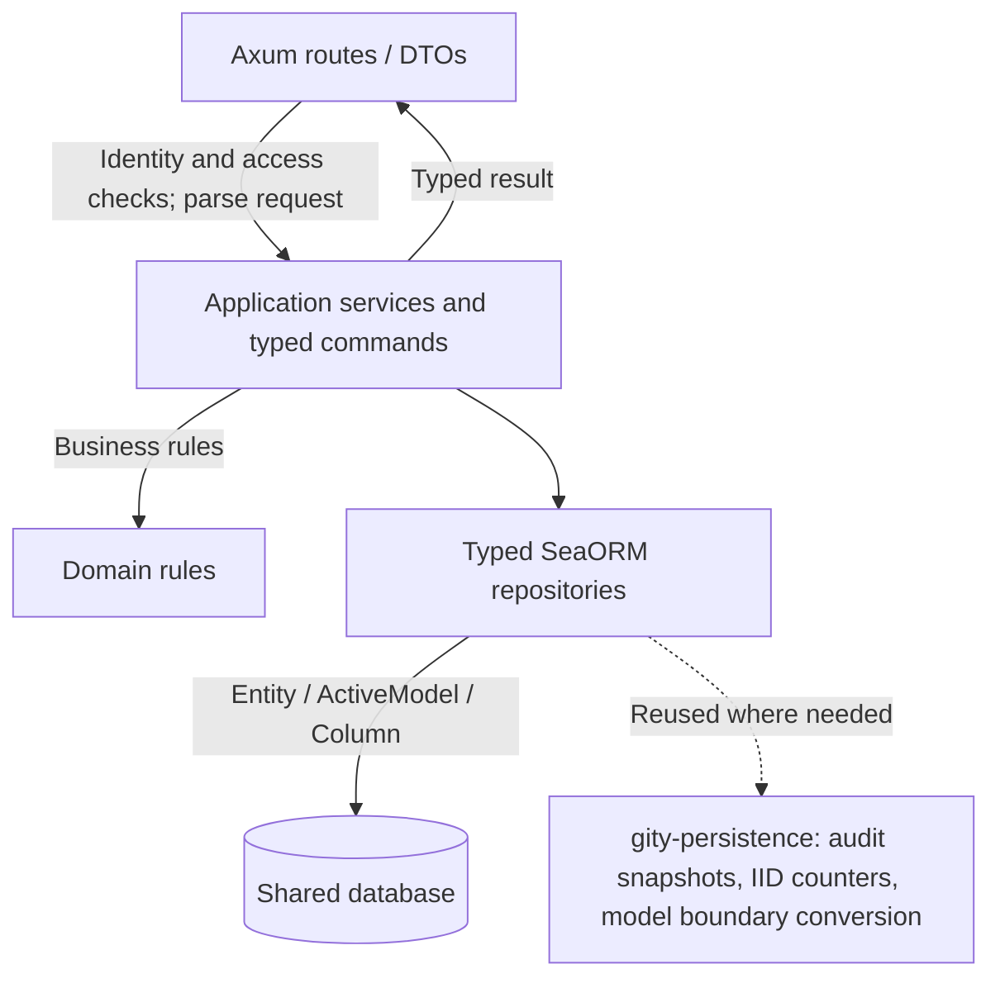
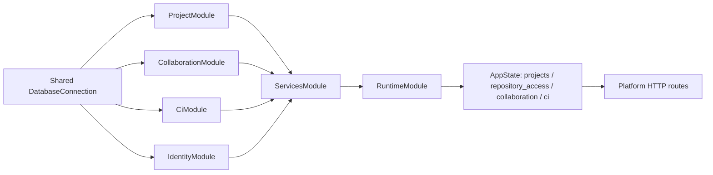

[简体中文](../../zh/architecture/typed-persistence.md) · [English](typed-persistence.md)

# Business persistence and dependency composition

The HTTP adapters for projects, collaboration, and CI parse requests into typed application commands. Application services apply business validation and call SeaORM repositories. Repositories access the database through entities, active models, typed columns, and transactions. Business rules do not depend on Axum, HTTP DTOs, or transport protocols.

## Context responsibilities

| Crate | Application responsibility | Main boundary |
| --- | --- | --- |
| `gity-projects` | Projects and organizations, memberships, and repository access settings | Exposes `ProjectService` and `RepositoryAccessService`; covers branch protection, access credentials, CI variables, LFS, and Registry settings |
| `gity-collaboration` | Issues, comments, merge requests, approval rules, milestones, releases, Wiki, and notifications | HTTP routes remain in the platform; application commands and database repositories live in this context crate |
| `gity-ci` | Pipelines, jobs, Runner state, and execution records | Server-side orchestration and persistence; Runner remains a separate execution process |
| `gity-persistence` | Persistence operations shared across contexts | Typed audit snapshots, IID counters, and the model-to-JSON presentation boundary |

The `gity-platform` route adapters check identity and permissions, parse requests, and map application results to the existing response DTOs. Domain rule modules do not read HTTP requests or depend on SeaORM. Application services use typed repositories, but some application service APIs return `gity-entities` models; route adapters map those models to response DTOs and exclude secret fields during mapping. Entity types therefore do not pass through directly to HTTP responses.

## FluxDI composition

Each business crate exports its own FluxDI module. The platform `ServicesModule` imports identity, collaboration, CI, and project modules sharing one SeaORM connection. `RuntimeModule` imports those services and composes storage, Git, and search before resolving `AppState`. HTTP handlers call the corresponding service. Standalone and process entry points use the platform composition entry point to assemble these modules.

Dependency injection registers and resolves services; application services, domain rules, and repositories still implement business behavior. Sharing a connection does not mean that contexts have separate databases.

## Transactions and audit records

Repository methods that need several database operations to remain consistent explicitly open SeaORM transactions and perform related reads, writes, and audit inserts within them. For example, audit snapshots for members, branch protections, approval rules, CI variables, and deploy keys save only fields explicitly listed in code; secret fields are excluded. The caller passes the same transaction to the audit operation, so the business change and its audit record commit or roll back within that transaction.

Project-scoped identifiers for issues, merge requests, milestones, and pipelines are allocated by `gity-persistence::next_iid`. It uses a typed counter Entity, increments the counter through an upsert, and reads the new value in the same transaction. `CounterKind` restricts the supported identifier categories, so callers do not build table names or SQL strings.

`gity-persistence::model_value` converts a serialized scalar model to JSON for the existing HTTP presentation layer and normalizes timestamps. Response presentation must still explicitly exclude credentials and other secrets; this conversion is not a general-purpose database CRUD API.

## Database foundation and test fixtures

`gity-core::Db` connects to the database, identifies its backend, and starts migrations. Business table access goes through SeaORM entities and repositories. Fixture helpers that operate on data by table name and JSON fields support test setup and assertions and are gated by the `test-fixtures` feature. Application crates enable the feature explicitly in development dependencies; normal runtime dependencies do not enable it.

This page describes code structure and transaction call sites. It does not claim that cross-database concurrency behavior, container images, or deployment architectures have passed black-box acceptance. See [Current verification status](../verification.md) for recorded test execution results.

## Implementation locations

- [Platform runtime composition](https://github.com/lyonbrown4d/gity/blob/main/crates/gity-platform/src/composition.rs)
- [Platform application state](https://github.com/lyonbrown4d/gity/blob/main/crates/gity-platform/src/lib.rs)
- [Project services and repositories](https://github.com/lyonbrown4d/gity/tree/main/crates/gity-projects/src)
- [Collaboration application services](https://github.com/lyonbrown4d/gity/tree/main/crates/gity-collaboration/src)
- [CI application services](https://github.com/lyonbrown4d/gity/tree/main/crates/gity-ci/src)
- [Shared persistence operations](https://github.com/lyonbrown4d/gity/tree/main/crates/gity-persistence/src)
- [Database connection and migration entry point](https://github.com/lyonbrown4d/gity/blob/main/crates/gity-core/src/database.rs)

