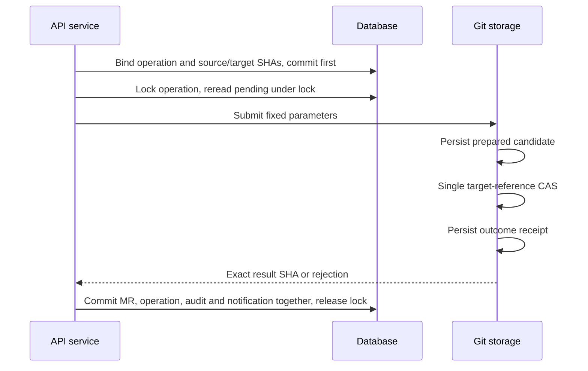

<div lang="en">

[简体中文](../zh/merge-recovery.md) · [English](merge-recovery.md)

# Interrupted MR Merges and Recovery

An MR merge changes both Git references and database state. The implementation first persists immutable operation parameters, executes Git, and then commits MR state using Git receipts. There is no distributed transaction between Git and the database, and multiple Git references are not committed atomically. A timeout or database error alone, or the current target branch tip, cannot establish that a merge failed.

## Normal Execution Order

Clients call `POST /api/v1/projects/{id}/merge-requests/{iid}/merge`. The server rechecks caller permission, MR state, approvals, pipelines, and target branch protection. A database transaction then binds an active operation to the MR, fixing its UUID v7, original actor, source/target branches and SHAs, message, author, and timestamp, and commits this durable operation record first. Concurrent requests reuse the same active operation rather than creating independent candidates.

Before invoking Git, the server acquires the operation's database lock and rereads its state under that lock. Merge execution, background read-only recovery, and owner abort share this locking path, preventing different processes from handling the same operation concurrently. PostgreSQL/MySQL use a row lock and SQLite uses a write-transaction lock; a process-local mutex alone is insufficient. If the locked operation is already complete, the server returns its stored result without observing or modifying Git again.

With the operation lock held, execution proceeds as follows:

1. Lock the operation outcome reference, then source and target branches; compare locked branch SHAs with the persisted values.
2. Compute the candidate commit and persist its SHA and complete parameters at `refs/gity/merge-prepared/{operation_key}`.
3. Update only the target branch while its lock is held and the expected old SHA matches: a target-reference compare-and-set (CAS).
4. Persist an immutable applied or rejected receipt at `refs/gity/merge-operations/{operation_key}`.
5. Complete the database transaction held throughout these steps: update operation state and clear the MR's active-operation binding. For success, save the exact `merge_commit_sha`, actor, and time, and write audit and notification records in that same transaction. Commit releases the operation lock.



The prepared reference, target branch, and outcome reference are persisted separately. A git2 transaction does not make this a multi-reference atomic commit. Receipts containing a candidate result parent that candidate commit so that all-reference Git backups, replication, and garbage collection retain the exact result. The server owns `refs/gity/**`; client updates are rejected and HTTP/SSH advertisements hide these references.

The operation lock spans Git outcome observation or mutation and database completion. It prevents execution, recovery, and abort from interleaving, without making Git and the database atomic. Distributed Git placement accounting runs outside the lock: `begin_write` selects a node before acquiring the operation lock, and completion accounting follows database transaction release. While locked, a fixed-node router performs only local Git or node RPC, without querying placement through a second database connection; this avoids SQLite self-locking. Uncertain RPC outcomes retain the pending-write marker.

After the database commit, background delivery triggers a push pipeline for the target branch. Repeated delivery uses an existing uniqueness key to deduplicate. If the MR/audit/notification database transaction fails, it does not expose a partially committed subset of those records.

## Read-only Recovery Decisions

Maintenance scans `pending` operations and `applied` operations whose completion events remain undelivered. The interval is `search.refresh_interval_seconds`; merge recovery still runs when search indexing is disabled. It reads Git proof only, never replays a Git mutation for the original actor, and does not authorize a new merge when that actor has since lost access.

| Git evidence | Recovery action |
| --- | --- |
| An outcome receipt matches every bound parameter | Complete database records from that receipt; rejected receipts become `rejected`. |
| Only prepared exists, and the current target equals or descends from its candidate | Record the candidate's exact SHA, not a later target tip. |
| No receipt, or the prepared candidate is absent from current target history | Keep `pending`; do not write Git or guess success/failure. |
| Receipt parameters differ, objects are missing, storage is unreachable, or the database still fails | Report the pending error and retain the operation for investigation. |

If Git succeeds and the database commit fails, recovery records the original merge SHA even after the target advances. Merely finding the source branch in history, or a similar-looking target, does not replace proof bound to the operation. A crash after prepared, a force rewind, or changes to pinned branches may require operator action.

## Resolve Persistent Pending Operations

1. Correlate `active_merge_operation_id` from MR detail, operation IDs in logs, and the `merge_operations` database record. Check `operation_key`, original actor, pinned SHAs, and state. Confirm Git storage and database availability first.
2. An authorized operator should inspect the repository's prepared/outcome receipts and candidate commit read-only. Ordinary SSH advertisements hide these internal references. Do not delete receipts, clear database bindings manually, or move the target branch merely to remove the pending state.
3. If application proof exists, allow maintenance to complete records, or have a caller who still has merge permission request merge again. Background recovery records an already proven result and does not advance branches.
4. Without application proof, a currently authorized caller may explicitly retry merge. The server repeats current permission and business checks and reuses the original operation/candidate. It proceeds only when pinned source/target SHAs still match. Prepared plus changed branches remains pending investigation; a retry is not a new merge intent.
5. To stop this operation, a caller with project owner-level permission calls abort with an actual reason.

```http
POST /api/v1/projects/{id}/merge-requests/{iid}/merge/abort
Authorization: Bearer <owner-token>
Content-Type: application/json

{"reason":"Inspected repository and pinned SHAs; stop this merge operation"}
```

Abort checks application proof first. If proof exists, it completes the original merge records and does not rewind Git. Otherwise it writes an immutable rejection receipt, records the owner and reason, clears the active binding, and leaves the MR opened. Stale requests read the rejection and cannot apply that old operation after abort. A later merge must pass normal permission/business checks and bind a new operation. No pending operation or an empty reason causes rejection.

## Backup and Verification Scope

MR recovery requires consistent database records, complete Git objects, and `refs/gity/**` references. Restoring only the target branch or exporting only client-visible references loses proof. See [deployment and recovery boundaries](production-deployment.md) for complete offline project snapshots.

Related tests cover Git success/database failure, exact-SHA recovery, repeated completion, concurrent calls, prepared interruptions, and owner abort. Container black-box cases also check real HTTP Git objects, process restarts, and audit/notification consistency. Their presence does not mean image acceptance has passed. See [verification status](verification.md) for actual Standalone/distributed × Debian/Alpine runs.

</div>
