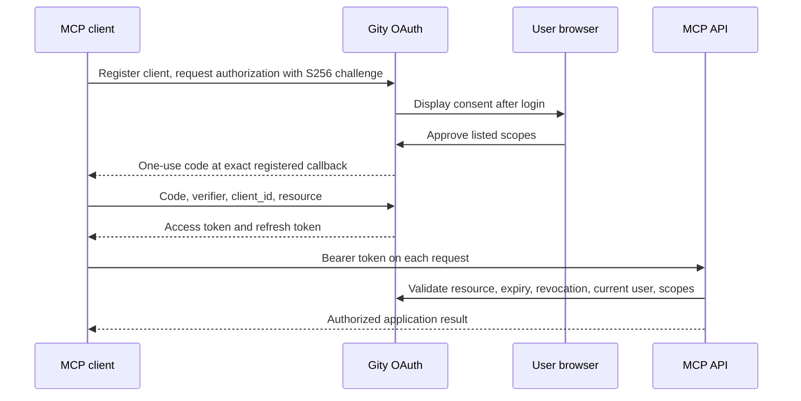

# Administration and MCP authorization

## Administrator initialization

Configuration bootstraps an administrator, named `root` by default. Ordinary registration creates ordinary users. Login authenticates existing accounts and never registers one implicitly.

```toml
[bootstrap]
enabled = true
username = "root"
# email = "admin@example.com"
# initial_password_file = "/run/secrets/gity_root_password"
# generated_password_file = "/var/lib/gity/bootstrap/admin-password"
```

Without `initial_password_file`, the service generates a cryptographically random password in `storage.root/bootstrap/admin-password`. On Linux the generated directory must belong to the current user with mode `0700`, and the file must have mode `0600`. Symlinks and generated files belonging to other users are rejected. Keep passwords out of CLI arguments, logs, and image layers.

The unique bootstrap claim, administrator, password, and personal organization commit in one database transaction. Only its winning process accesses the password file. Configuration changes, restarts, demotion, and deletion never reset the password or restore privileges automatically. A generated file older than 24 hours is removed on a subsequent startup; the account password does not expire as a result. Supplied input password files are never removed.

In distributed deployments the API process bootstraps the administrator; Git and Worker roles do not. Database migrations still require one migration job. For operator recovery, run `set-password` or `grant-admin` against the intended database as explicit administrative actions.

## MCP OAuth

MCP uses existing Gity users with persisted OAuth authorization. Its resource is the external `http.base_url` plus `/mcp`.

| Endpoint | Purpose |
| --- | --- |
| `/.well-known/oauth-authorization-server` | Authorization server metadata |
| `/.well-known/oauth-protected-resource/mcp` | MCP resource metadata |
| `/oauth/register` | Bounded public client registration |
| `/oauth/authorize` | Validate the request and enter browser consent |
| `/api/v1/oauth/requests/{request_id}` | Read a pending request or approve/deny it |
| `/oauth/token` | Form-encoded authorization-code exchange and refresh |
| `/oauth/revoke` | Form-encoded token revocation |

The external issuer requires HTTPS, except for loopback HTTP, and cannot contain a path prefix, query, or user information. Public clients use no client secret and must use PKCE `S256`. Redirect URIs must exactly match registration; HTTPS and loopback HTTP are accepted. Resources must also match exactly. Consent requires an existing browser session, displays the client, scopes, and target resource, and requires explicit approval or denial.



Scopes are `mcp`, `read_api`, `write_api`, and optional `admin_mode`. Queries require `read_api`, mutations require `write_api`, and both require `mcp`. Ordinary grants from an administrator do not inherit super-administrator privileges. Granting `admin_mode` requires the current administrator to re-enter their password; execution rechecks account state and privilege. Scopes never replace project or organization authorization.

Tokens bind to the `/mcp` resource and cannot authenticate REST or GraphQL requests. Those APIs use existing sessions or personal tokens. The database stores only code/token digests. Codes are single-use; refresh tokens rotate, and reuse of a consumed refresh token revokes the entire grant. Grant revocation is persisted separately and checked alongside each token, including descendants created concurrently. Clients should serialize refreshes; explicitly revoking either token also revokes its grant. Clients and grants survive restarts.

`[oauth]` defaults are 600 seconds for authorization codes, 3600 for access tokens, 2592000 for refresh tokens, 300 for pending consent, and at most 1000 dynamic clients. Configuration files and `GITY_OAUTH__...` variables override these bounds, which are validated at startup. See [API transports](api-transports.md) for external addresses, origin policy, and request limits.
