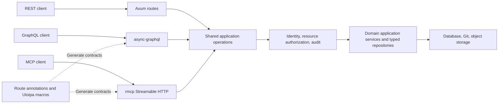

# REST, GraphQL, and MCP

The platform serves three business APIs on the same HTTP listener. `PlatformModule` composes them for standalone and independent API deployments. GraphQL and MCP use the same database and application operations; they do not call REST routes over HTTP.



`gity-api-macros` separates existing business entry points into REST wrappers and shared operations. `gity-api-contracts` defines request context, operation contracts, and errors. The platform registers business operations; `gity-graphql` and `gity-mcp` adapt their protocols. FluxDI composes both adapters and validates their contracts before binding the listener.

## Capability boundaries

| Interface | Purpose |
| --- | --- |
| `/api/v1/...` | REST business management, authentication, sessions, and protocol entry points |
| `/api/graphql` | Individually named queries and mutations with typed inputs and outputs |
| `/mcp` | Streamable HTTP; `tools/list` returns operations and schemas, `tools/call` invokes application use cases |
| Git HTTP/SSH, LFS, package protocols, OCI | Native streaming, conditional requests, and client compatibility |

GraphQL and MCP manage projects, collaboration, repository metadata, CI, and artifact metadata. Git packs, LFS objects, container layers, package upload/download, Runner task claims, and session authentication retain dedicated endpoints. Tools do not embed these large payloads as Base64.

Inputs use `path`, `query`, and `body` groups; IDs are strings. Operations returning arrays also accept `pagination.page` and `pagination.page_size`, defaulting to page 1 with 50 entries, at most 100. This bounds returned entries; existing underlying application queries may still fetch a complete collection.

GraphQL disables introspection by default and does not serve a Playground. Defaults are depth 12, complexity 200, and a 1 MiB request body. Queries and mutations appear on `Query` and `Mutation`; error extensions contain `code` and `status`, without internal server-error details. MCP exposes one tool per operation and wraps results as `structuredContent.result`.

## Configuration

Place these settings in the service configuration file, or override them with `GITY_API__...` environment variables. Precedence remains code defaults, configuration file, environment, then explicit CLI arguments.

```toml
[api]
graphql_enabled = true
mcp_enabled = true
graphql_introspection = false
graphql_max_depth = 12
graphql_max_complexity = 200
max_request_bytes = 1048576
mcp_max_concurrent_requests = 64
mcp_request_timeout_seconds = 30
mcp_allowed_origins = []
mcp_allowed_hosts = []
```

Empty Origin and Host lists derive from `http.base_url`. Set the external address behind a reverse proxy, and explicitly allow any additional browser origins. MCP authenticates each HTTP request and tool invocation; a session identifier never confers authorization. See [Administration and authorization](administration.md) for OAuth.

## Development documentation and release artifacts

Utoipa macros remain available for development and offline contract generation. Only debug builds explicitly enabling `api-docs` serve Swagger UI and OpenAPI endpoints:

```sh
cargo run -p gity-standalone --features api-docs
```

Release builds reject `api-docs`. Release binaries and images exclude Swagger UI assets. `/docs`, `/docs/`, `/openapi.json`, and documentation asset paths return 404 instead of the SPA home page. Git LFS business routes are registered separately and remain available independently of documentation.
