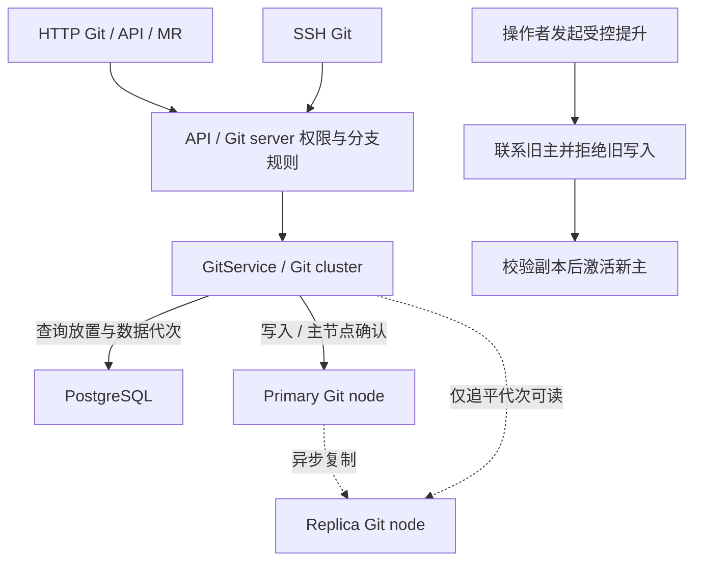
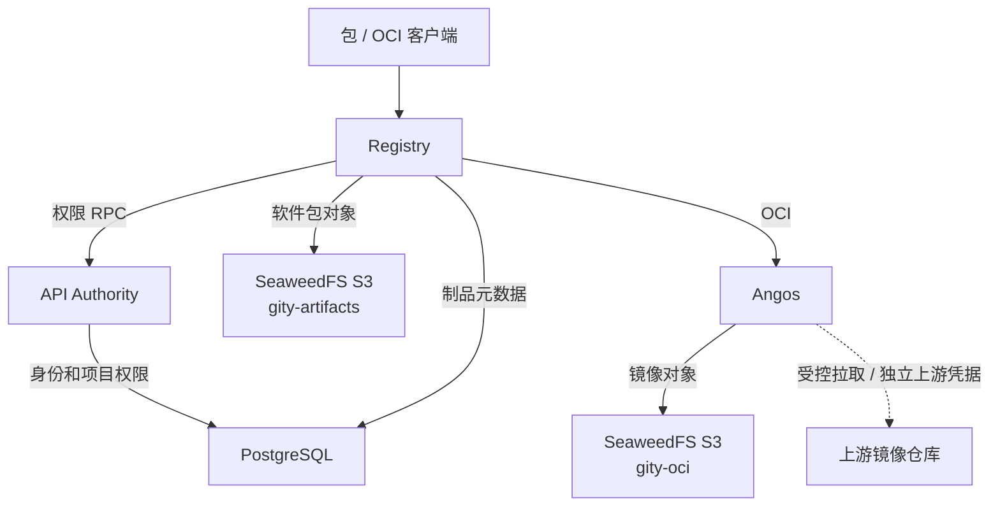
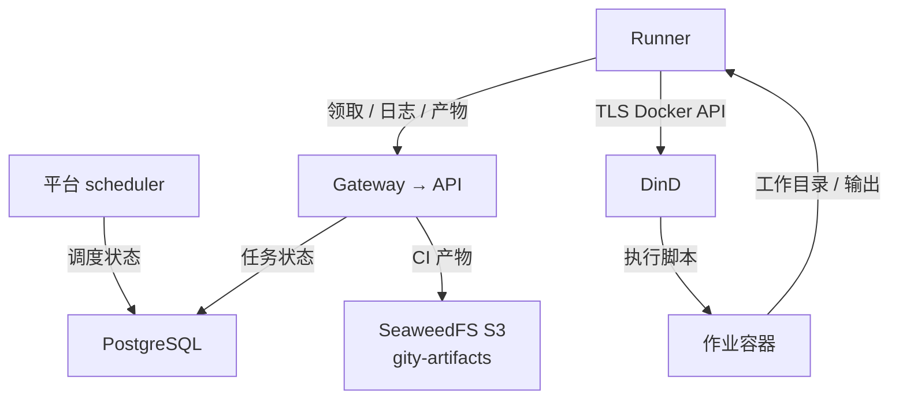

[简体中文](data-flows.md) · [English](../../en/architecture/data-flows.md)

# Git、制品与 CI 数据流

## Git 读写

HTTP Git、API 文件提交、MR 合并和 SSH 最终进入 Git 服务后端。入口负责用户权限和分支规则；配置集群时，Git cluster 查询放置与数据代次，再通过内部 RPC 操作 Git node。数据库存放控制元数据，裸仓库存放 Git 对象。

写入由主节点确认，再异步复制到副本。读取副本前必须满足对应数据代次要求；有未完成写入或副本未追平时，不能将旧内容作为最新读取结果。主节点确认不保证副本已经持久化。

受控提升要求旧主节点可达：先拒绝旧主上的后续写入，再核对目标副本并激活新主。旧主不可达时不自动选择另一个节点继续写入。当前不提供 Raft 无损自动故障切换。

## 软件包、OCI 与 CI

图中数据库与 S3 使用分布式示例；Standalone 默认使用 SQLite 和本地对象目录。

软件包 Registry 使用协议适配处理 Cargo、npm、PyPI、Maven、NuGet、Go 和 Generic。独立部署时先查询 API Authority 的项目权限；制品服务将元数据写入 PostgreSQL，将二进制对象写入存储。Standalone 使用相同协议与制品服务，权限调用和存储可在本机完成。

OCI 请求经过 Gity 策略与权限检查后进入 Angos。Compose 中 Angos 使用独立 `gity-oci` 桶；软件包及 CI 产物使用 `gity-artifacts`。Mirror 的上游必须由配置允许，用户令牌与上游凭据分开，缓存不等于 Git 副本或故障切换机制。

CI 服务端验证 YAML、调度任务并保存执行状态。Runner 领取任务、取得源码，通过 DinD 启动作业容器，再回传日志和产物。用户脚本由 Runner 执行环境运行，平台调度任务不直接执行用户脚本。

不同图中的 PostgreSQL 与同名桶表示相同共享服务；实线表示请求或数据写入，虚线表示受状态约束的副本读取、异步复制或受控上游拉取，以边线标签为准。

源码依据：[Git 后端](https://github.com/lyonbrown4d/gity/tree/main/crates/gity-git-cluster/src)、[包服务](https://github.com/lyonbrown4d/gity/tree/main/crates/gity-package-registry/src)、[OCI 网关](https://github.com/lyonbrown4d/gity/tree/main/crates/gity-oci/src)、[Runner](https://github.com/lyonbrown4d/gity/tree/main/apps/gity-runner/src)。

## CI 执行链路

