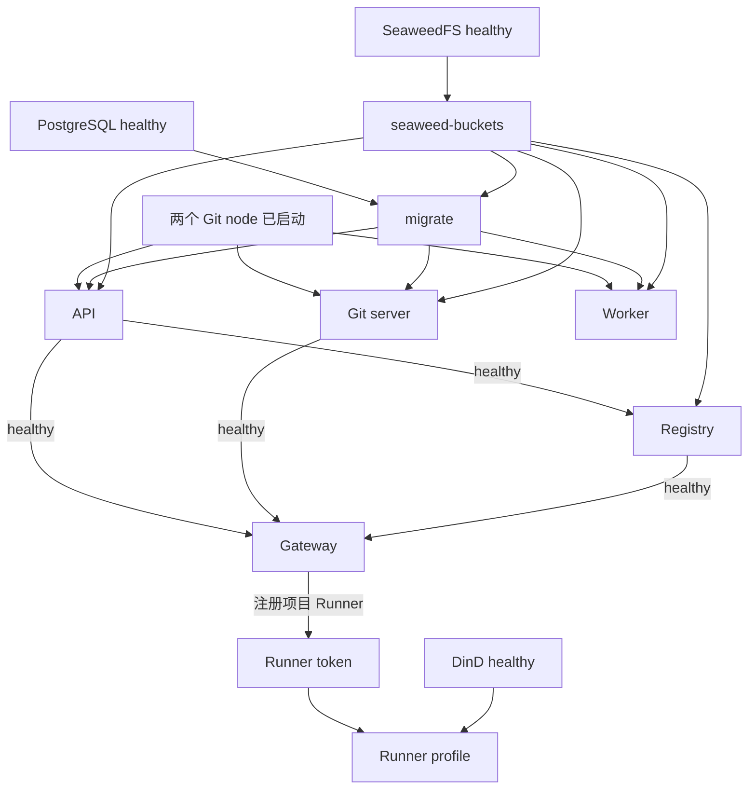

[简体中文](distributed.md) · [English](../../en/architecture/distributed.md)

# 分布式组件如何启动

当前示例将组件拆为独立进程和容器，运行在一台 Docker 主机上，共用 PostgreSQL 和 SeaweedFS。各进程分别运行自己的 FluxDI Application，不存在跨进程共享的 DI 容器。

## 请求和数据流

请求路由按当前 `gateway.toml`：普通 HTTP Git 仍转发到 API，不是 Git server。Git server 的 HTTP 监听在容器内 `8081`；公开 SSH 由它处理。OCI 端口直接发布自 Registry，不经过边缘 Gateway。

## Compose 的启动依赖

1. PostgreSQL、SeaweedFS 和两个 Git node 可以先启动。Git node 使用各自仓库卷，不依赖数据库。
2. `seaweed-buckets` 等 SeaweedFS 健康后创建 `gity-artifacts`、`gity-oci` 桶；`migrate` 等数据库健康及桶初始化成功，再执行一次迁移并退出。
3. API、Git server 和 Worker 等待迁移完成、Git node 已启动，以及相应存储依赖。Git node 的条件是 `service_started`，不是 RPC 就绪或仓库副本追平。
4. Registry 等 API 和对象存储健康后启动；其进程监督 Angos、OCI gateway 和独立软件包 HTTP module。包和 OCI 权限通过 API Authority RPC 查询。
5. Gateway 等 API、Git server、Registry 的健康检查通过后启动公开 HTTP/SSH 入口。
6. 基础栈不启动 Runner。先通过项目注册取得 Runner token，再启用 `runner` profile；Runner 等 Gateway 与 DinD 健康后连接并领取任务。

这是 Compose 依赖条件，不是所有节点严格串行启动。具体命令及秘密文件准备见 [Compose 操作](../deployment/compose.md)。

## 应用角色怎样使用共同代码

| 角色默认命令 | HTTP | SSH | CI scheduler | maintenance | 自动迁移 |
| --- | --- | --- | --- | --- | --- |
| Standalone / `standalone` | 是 | 配置开启时 | 是 | 是 | 是 |
| API / `serve` | 是 | 否 | 否 | 是 | 否 |
| Git / `serve` | 是 | 配置开启时 | 是 | 是 | 否 |
| Worker / `worker` | 否 | 否 | 是 | 是 | 否 |

以上来自 `ApplicationRole` 和 `PlatformOptions` 的当前默认值，不表示角色只包含表内功能。maintenance 包含索引刷新和启用制品时的待清理对象处理。配置 Git cluster 的平台 module 还会导入副本推进任务；该任务不是只在 Worker 中运行。

Registry、Gateway、Git node 使用各自入口装配 module。Registry 的包服务使用独立监听器；与 standalone embedded 形式共享协议及制品实现。所有入口通过关闭信号进入 module shutdown。

## 身份、存储与失败行为

API、Git server、Worker 及软件包 Registry 使用共享数据库，但写入 node ID 分别为 `1`、`2`、`3`、`5`。新增写入进程必须分配唯一 node ID。搜索索引和各服务工作状态使用进程对应的本地卷。

内部 Authority / Git RPC 使用 TLS、客户端证书和 peer 凭据。Git node 不接收浏览器身份作为直接授权依据；平台先执行产品权限，再发起可信内部操作。Registry 授权服务不可达时返回失败；Gateway 不自建权限缓存绕过主服务。

Git 的 `replicas = 2` 表示主节点加一个副本。写入先由主节点确认，再异步复制；只允许满足数据代次要求的副本参与读取。受控提升必须联系旧主节点拒绝旧写入，再核对并激活副本。旧主不可达时提升失败，当前没有 Raft 无损自动故障切换。

Gateway 的 `/readyz` 检查本地监听任务状态；不能证明数据库、API、Git node 或存储链路都正常。Compose 初始健康依赖也不构成后续故障自动恢复保证。

源码依据：[应用角色](https://github.com/lyonbrown4d/gity/blob/main/crates/gity-platform/src/application.rs)、[Compose 服务依赖](https://github.com/lyonbrown4d/gity/blob/main/deploy/components/distributed-components.compose.yaml)、[Gateway 配置](https://github.com/lyonbrown4d/gity/blob/main/deploy/components/config/gateway.toml)、[Git cluster module](https://github.com/lyonbrown4d/gity/blob/main/crates/gity-git-cluster/src/module.rs)。

