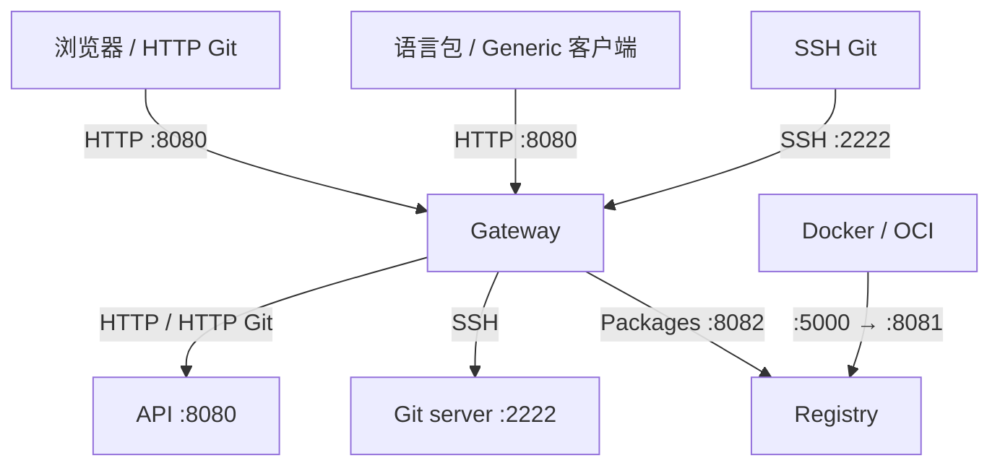

<div lang="zh-CN">

[简体中文](overview.md) · [English](../../en/architecture/overview.md)

# 整体架构




Gity 采用共享业务库和多个可部署入口。Standalone 在一个平台进程内组合主要模块；分布式布局把入口、平台、Git 存储和制品协议服务放到不同进程。两者复用业务实现。

## 代码分层

```text
apps/                   可执行入口与进程配置
  ↓
crates/gity-platform    平台路由、应用编排与平台业务
  ↓
身份 / 制品 / Git 等领域服务和端口
  ↓
SeaORM 仓储、Git 本地或 RPC 适配、对象存储适配
```

`apps/` 不供其他应用导入业务实现。`crates/` 保存可复用组件，`migrations/` 保存数据库迁移，`xtask/` 保存构建和验证工具。

当前按身份权限、项目协作、Git、CI、制品等上下文拆分。身份与制品已有独立服务和仓储；组织项目、Issue、MR、CI 等部分实现仍集中在 `gity-platform`。这些上下文边界并不表示每个上下文都拥有独立服务和数据库。

## 运行依赖

数据库保存业务元数据，不保存 Git 对象。Git 对象保存在裸仓库中；软件包、附件和 CI 产物通过存储适配访问。分布式示例使用 PostgreSQL 和 SeaweedFS；各平台进程仍共享该 PostgreSQL，尚未实现每个上下文独立数据库。

Web 是编译后的静态资源，由平台 HTTP 服务提供，不是独立的 Node 服务。Monaco、Milkdown 作为本地第三方资产随 Web 分发。

## 公共基础能力

| 能力 | 当前实现 |
| --- | --- |
| 装配 | FluxDI 注册、解析和 module 生命周期 |
| HTTP / 并发 | Axum、Tokio；传输路径保留流式读写 |
| 持久化 | SeaORM Entity、ActiveModel、事务；部分平台仓储使用现有通用接口 |
| 实体标识 | 固定 Snowflake；各分布式写入进程配置唯一 node ID；对外 JSON 主键用字符串 |
| 操作标识 | UUID v7；秘密凭据使用密码学随机数 |
| 配置 | 代码默认值 < 文件 < 环境变量 < 显式 CLI |
| 可观测性 | Tracing、Prometheus、可选 OTLP；各进程分别初始化 |
| API 文档 | Utoipa 宏生成 OpenAPI，平台提供 `/docs`、`/openapi.json` |
| 多语言 | 前后端复用 `gity-i18n`，服务端语言按请求选择 |

## 部署与保证范围

Standalone 默认包含全部业务组件，但 Runner 和 Angos 是被监督的独立子进程；Compose 还运行独立 DinD。它不等于整个安装只有一个 OS 进程。

分布式组件可独立打包和启动，但存在明确依赖，不能任意移除。当前 Compose 不是多主机、高可用或独立数据库的完整部署方案。组件职责见[依赖表](components.md)，启动与关闭见 [Standalone](standalone.md) 和[分布式模式](distributed.md)。

源码依据：[平台装配](https://github.com/lyonbrown4d/gity/blob/main/crates/gity-platform/src/composition.rs)、[应用角色](https://github.com/lyonbrown4d/gity/blob/main/crates/gity-platform/src/application.rs)、[Workspace](https://github.com/lyonbrown4d/gity/blob/main/Cargo.toml)。

</div>
