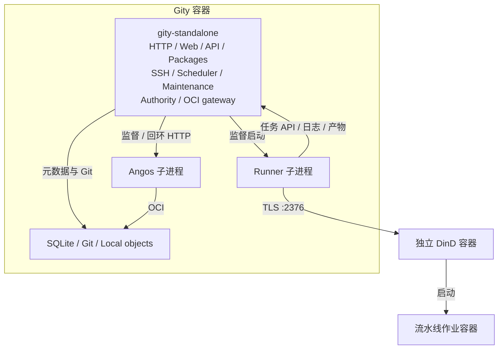

[简体中文](standalone.md) · [English](../../en/architecture/standalone.md)

# Standalone 如何启动

以下说明使用仓库提供的 `deploy/components/config/standalone.toml` 和 standalone Compose。该配置开启全部业务模块，采用 SQLite、本地裸仓库和本地对象目录。

## 进程组织

一个全功能入口不等于所有工作在一个线程或 OS 进程里。HTTP、SSH、调度和维护使用 Tokio 任务；Angos 与 Runner 使用独立子进程，用户脚本在 Runner 启动的作业容器中执行。

## 从配置到监听

1. `apps/gity-standalone` 调用 `application::run(Standalone)`。Clap 解析入口参数，加载并验证文件/环境配置，初始化日志、指标和可选追踪。
2. `composition::compose` 建立数据库与存储适配，使用 `RuntimeModule` 装配身份仓储、Git 后端、搜索索引和 `AppState`；启用软件包时构造制品服务。未配置 Git cluster 时选本地 Git 后端。
3. 默认命令为 `standalone`，先执行 Rust schema 迁移。配置、迁移或依赖构造失败时启动返回错误。
4. 组合层登记 Angos、Platform、Authority、OCI gateway、Runner 等 module。启用项由组件配置控制；`PlatformModule` 还导入软件包 embedded module 和可选 Git cluster module。
5. `fluxdi::Application::bootstrap()` 调用 module 生命周期。Platform 先绑定 HTTP/SSH 监听器，再启动服务、调度和维护任务。软件包 embedded module 复用平台 HTTP 路由，不另开 `8082`。
6. Runner module 启动 `gity-runner` 子进程，指向平台回环 HTTP 地址、私有项目令牌目录和配置的容器引擎。项目注册 Runner 后，令牌目录可用于本机 Runner 领取任务。

Standalone 组件共享该平台进程的数据库/存储状态及统一 ID 生成器，不为每个模块配置独立 Snowflake node ID。

## 运行和关闭

平台监督 HTTP、SSH、调度和维护任务；任务意外退出会触发停止。另有周期性监测检查 Runner、Authority、OCI gateway 与 Angos 生命周期句柄。Angos 重启超过配置限制会使整体退出，不把 HTTP 仍能响应当作其他模块继续正常运行的依据。

收到 SIGTERM 或 Ctrl-C 后，调用 `Application::shutdown()`。各 module 取消任务、关闭监听并回收子进程；Runner 先接收 SIGTERM，等待超时后强制结束。监测的是进程和任务状态，不构成数据库、对象存储及全部业务链路的持续健康证明。

## Compose 组织

Compose 先启动 DinD 并等待其健康检查，再启动 Gity 容器。默认公开 HTTP `8080`、SSH `2222`、OCI `5000`。Authority `9100` 和 Angos `18000` 使用容器内回环地址。

`gity-data` 保存平台状态；DinD 的数据与证书各有卷。Runner 工作目录以相同绝对路径挂载到 Gity 和 DinD，保证作业容器能找到源码。DinD 使用 privileged 模式，宿主机应专用于可信的容器任务环境。

实际准备、启动与停止命令统一见 [Compose 操作](../deployment/compose.md)，本页只解释启动机制。

源码依据：[Standalone 入口](https://github.com/lyonbrown4d/gity/blob/main/apps/gity-standalone/src/main.rs)、[组合 module](https://github.com/lyonbrown4d/gity/blob/main/crates/gity-platform/src/standalone/mod.rs)、[Platform 生命周期](https://github.com/lyonbrown4d/gity/blob/main/crates/gity-platform/src/lifecycle/mod.rs)、[Runner 生命周期](https://github.com/lyonbrown4d/gity/blob/main/crates/gity-platform/src/standalone/runner.rs)。

