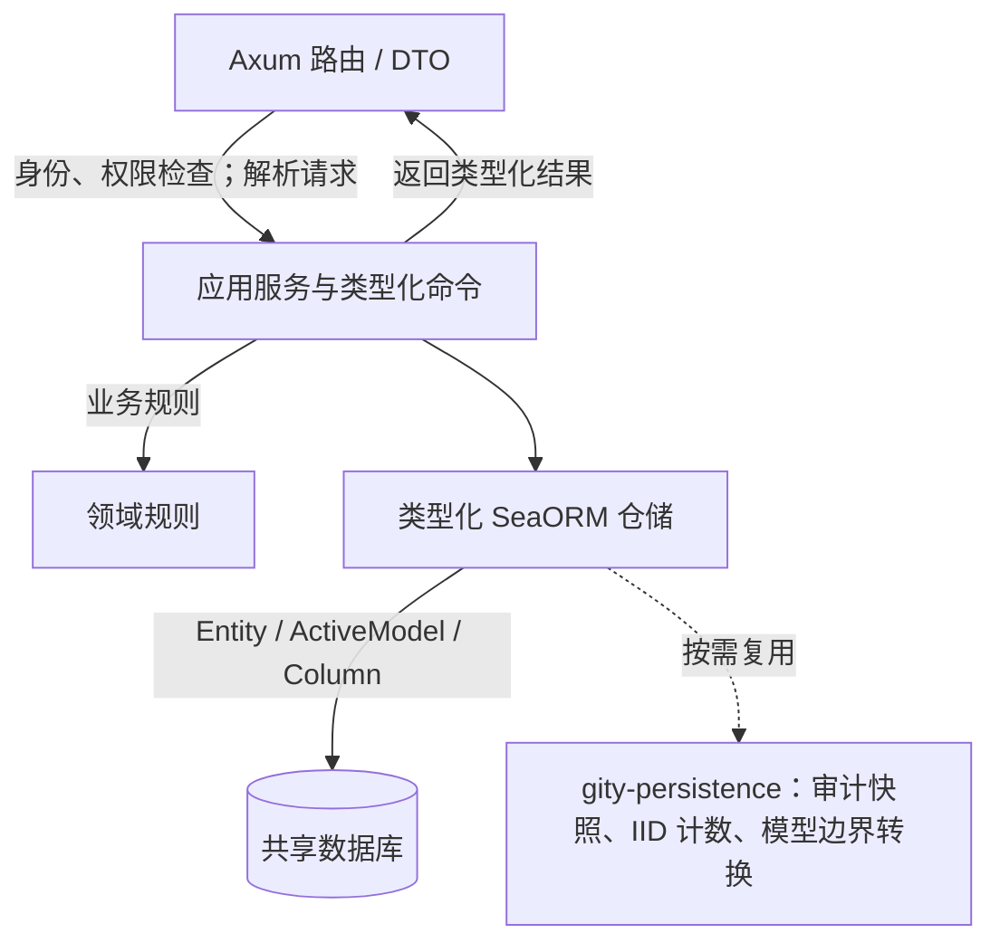
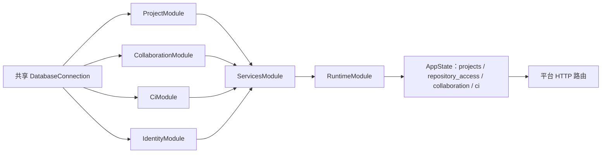

[简体中文](typed-persistence.md) · [English](../../en/architecture/typed-persistence.md)

# 业务持久化与依赖装配

项目、协作和 CI 的 HTTP 适配层将请求解析为类型化应用命令，应用服务执行业务校验并调用 SeaORM 仓储。仓储通过实体、活动模型、类型化列和事务访问数据库；这些业务规则不依赖 Axum、HTTP DTO 或传输协议。

## 上下文职责

| crate | 应用职责 | 主要边界 |
| --- | --- | --- |
| `gity-projects` | 项目与组织、成员关系，以及仓库访问配置 | 提供 `ProjectService` 和 `RepositoryAccessService`；覆盖分支保护、访问凭据、CI 变量、LFS 与 Registry 设置 |
| `gity-collaboration` | Issue、评论、MR、审批规则、里程碑、发布、Wiki 与通知 | HTTP 路由留在平台；业务命令与数据库仓储位于上下文 crate |
| `gity-ci` | 流水线、任务、Runner 状态与执行记录 | 服务端编排和持久化；Runner 仍是独立执行进程 |
| `gity-persistence` | 跨上下文复用的持久化操作 | 类型化审计快照、IID 计数和模型到 JSON 展示边界 |

`gity-platform` 的路由适配器负责身份和权限检查、解析请求以及把应用结果映射为既有响应 DTO。领域规则模块不读取 HTTP 请求，也不依赖 SeaORM。应用服务通过类型化仓储操作数据，但部分应用服务 API 会返回 `gity-entities` 的模型；路由适配器负责将模型映射为响应 DTO，并在映射时排除秘密字段。因此，实体类型不会从 HTTP 响应边界直接透出。

## FluxDI 装配

各业务 crate 导出自己的 FluxDI module。平台 `ServicesModule` 导入身份、协作、CI、项目模块，共享同一个 SeaORM 连接。`RuntimeModule` 导入这组服务并组合存储、Git 与搜索，解析应用服务后放入 `AppState`。HTTP 处理器从对应服务调用业务逻辑。Standalone 和各进程入口沿用平台组合入口装配这些模块。

依赖注入只负责注册和解析服务；业务行为仍由应用服务、领域规则和仓储执行。各模块共享连接不代表拥有独立数据库。

## 事务与审计

需要保持多个数据库操作一致的仓储方法显式开启 SeaORM 事务，并在该事务内完成相关读取、写入和审计记录。例如，成员、分支保护、审批规则、CI 变量和部署密钥的审计快照只保存代码明确列出的字段；秘密字段不进入快照。调用方把同一事务传给审计操作，使业务变更与审计记录在该事务范围内提交或回滚。

Issue、MR、里程碑和流水线等项目内编号由 `gity-persistence::next_iid` 分配。它使用类型化 counter Entity，通过 upsert 增加计数并在同一事务中读取新值。`CounterKind` 限定当前编号类别，避免调用端拼接表名或 SQL。

`gity-persistence::model_value` 仅用于把序列化后的标量模型转换为现有 HTTP 展示层使用的 JSON，并规范化时间戳。响应呈现仍须显式排除凭据等秘密数据；JSON 转换不应被用作通用数据库 CRUD 接口。

## 数据库基础层与测试夹具

`gity-core::Db` 负责连接、识别数据库后端和启动迁移。业务表访问通过 SeaORM 实体及仓储完成。按表名和 JSON 字段操作数据的 fixture helper 用于测试初始化与断言，受 `test-fixtures` feature 限制；应用 crate 在开发依赖中显式启用该 feature，普通运行依赖不启用。

本页描述代码结构和事务调用范围，不代表跨数据库并发行为、容器镜像或部署架构已完成黑盒验收。具体测试执行结果以[当前验证状态](../verification.md)记录为准。

## 实现位置

- [平台运行时装配](https://github.com/lyonbrown4d/gity/blob/main/crates/gity-platform/src/composition.rs)
- [平台应用状态](https://github.com/lyonbrown4d/gity/blob/main/crates/gity-platform/src/lib.rs)
- [项目服务与仓储](https://github.com/lyonbrown4d/gity/tree/main/crates/gity-projects/src)
- [协作应用服务](https://github.com/lyonbrown4d/gity/tree/main/crates/gity-collaboration/src)
- [CI 应用服务](https://github.com/lyonbrown4d/gity/tree/main/crates/gity-ci/src)
- [共享持久化能力](https://github.com/lyonbrown4d/gity/tree/main/crates/gity-persistence/src)
- [数据库连接与迁移入口](https://github.com/lyonbrown4d/gity/blob/main/crates/gity-core/src/database.rs)

