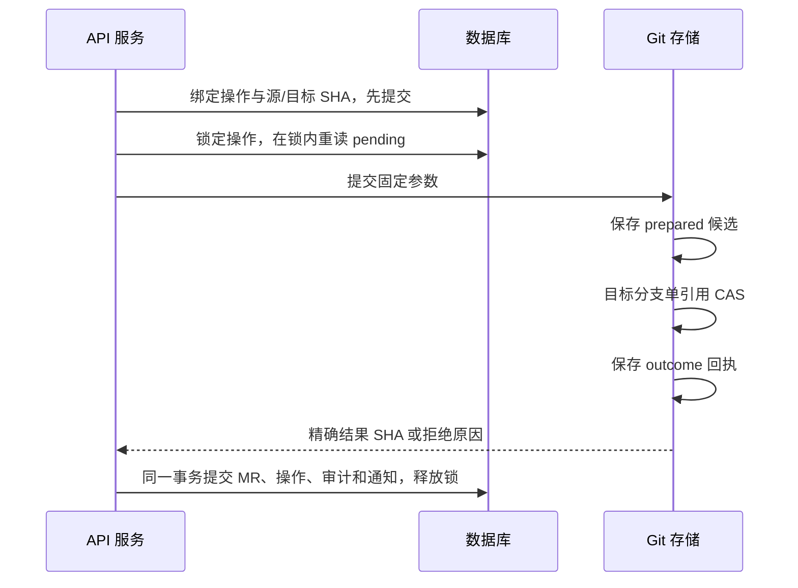

<div lang="zh-CN">

[简体中文](merge-recovery.md) · [English](../en/merge-recovery.md)

# MR 合并中断与恢复

MR 合并同时涉及 Git 引用和数据库状态。当前实现先保存不可变的合并操作，再执行 Git，最后凭 Git 回执提交 MR 状态。Git 与数据库之间没有分布式事务；Git 多个引用也不是一次原子提交。请求超时或数据库失败时，不能仅凭 HTTP 错误或当前目标分支尖端认定合并失败。

## 正常执行顺序

客户端调用 `POST /api/v1/projects/{id}/merge-requests/{iid}/merge`。服务端重新检查调用者权限、MR 状态、审批、流水线及目标分支保护规则。随后在数据库中为该 MR 绑定一条活动合并操作，固定操作 UUID v7、原执行人、源/目标分支与 SHA、消息、作者和时间，并先提交这条持久操作记录。并发调用复用同一条活动操作，不分别创建合并候选。

执行 Git 前，服务端取得该操作的数据库锁，并在锁内重新读取状态。合并执行、后台只读恢复和 owner abort 都使用同一套数据库锁，因此不同进程也不能同时处理同一操作。PostgreSQL/MySQL 使用行锁，SQLite 使用写事务锁；不能仅依靠进程内互斥。若锁内发现操作已经完成，直接返回已有结果，不再观察或修改 Git。

持锁后按以下顺序执行：

1. 锁定该操作的结果引用，再锁定源和目标分支；核对锁内分支 SHA 与已保存值一致。
2. 计算候选提交，并在 `refs/gity/merge-prepared/{operation_key}` 保存候选 SHA 及完整操作参数。
3. 在锁定且旧 SHA 匹配的条件下，仅更新目标分支，即目标引用的 compare-and-set（CAS）。
4. 在 `refs/gity/merge-operations/{operation_key}` 保存不可变的已应用或拒绝回执。
5. 凭已证明结果完成一直持有的数据库事务：更新操作状态、清除 MR 活动操作绑定；成功时保存精确 `merge_commit_sha`、合并人和时间，并在同一事务中写入审计和通知。提交后释放操作锁。



`prepared`、目标分支和 `outcome` 是分开持久化的引用。即使使用 git2 transaction，也不能把此顺序描述成多引用原子提交。包含候选结果的回执提交以候选提交为父对象，使精确结果可被 Git 的全引用备份、复制和垃圾回收正确保留。`refs/gity/**` 由服务端维护，客户端不能更新；HTTP/SSH 广告隐藏这些引用。

操作锁覆盖 Git 结果观察或写入，以及数据库完成记录；它防止执行、恢复与 abort 相互穿插，但不使 Git 和数据库成为原子事务。分布式 Git 的 placement 写入记账在锁外进行：先调用 `begin_write` 选择节点，再取得操作锁；释放数据库事务后才调用完成记账。持锁期间使用固定节点路由，仅执行本地 Git 或节点 RPC，不再通过第二个数据库连接查询 placement，避免 SQLite 自锁。不确定的 RPC 结果保留待确认写入标记。

数据库提交后，后台通过待投递标记触发目标分支的 push 流水线。重复投递使用已有唯一键去重；写入 MR、审计和通知的事务失败时，不会留下其中一部分已提交的状态。

## 只读恢复的判断

维护任务扫描 `pending` 操作，以及尚未投递完成事件的 `applied` 操作。周期取 `search.refresh_interval_seconds`，即使关闭搜索索引，合并恢复扫描仍会运行。它只读取 Git 证明，不替原执行人重做 Git 写入，也不会因原执行人后来失去权限而重新授权一次合并。

| Git 证据 | 恢复动作 |
| --- | --- |
| 存在参数完全一致的 outcome 回执 | 使用该回执完成数据库记录；拒绝回执记录为 `rejected`。 |
| 只有 prepared，当前目标等于候选或包含该候选作为祖先 | 保存候选的精确 SHA 为合并结果；不会改用后来推进的目标尖端。 |
| 无回执，或 prepared 候选不在当前目标历史中 | 保持 `pending`，不写 Git、不猜测成功或失败。 |
| 回执参数不符、对象缺失、存储不可达或数据库仍失败 | 记录待处理错误，保留操作以待后续核对。 |

因此，Git 已完成而数据库提交失败后，即使目标分支又前进了，恢复仍记录原合并 SHA。仅存在“源分支已被包含”或“当前目标看起来相似”不能替代绑定操作的回执。prepared 之后发生崩溃、强制回退或固定分支变化，都可能需要人工处理。

## 处理持续 pending

1. 从 MR 详情的 `active_merge_operation_id`、日志中的操作 ID 和数据库 `merge_operations` 记录核对 `operation_key`、原执行人、固定 SHA 和状态。先确认 Git 存储与数据库可用。
2. 由有运维权限的操作者只读检查对应仓库中的 prepared/outcome 回执及候选提交。内部引用不会通过普通 SSH 广告暴露；不要手工删除回执、清空数据库绑定或修改目标分支来让状态消失。
3. 若已有应用证明，等待维护扫描，或由仍有合并权限的调用者再次请求合并以完成记录。后台只会记录已发生的结果，不会推进分支。
4. 若没有应用证明，仍有权限的调用者可以明确再次请求合并。服务端重新做当前权限和业务检查，复用原操作及候选；只有固定源/目标 SHA 仍匹配时才继续。存在 prepared 且分支已变化时保持待核对，不能把重试当作新的合并意图。
5. 若决定终止这一轮操作，由具备项目 owner 权限的调用者使用下面的 abort 接口，并提供实际原因。

```http
POST /api/v1/projects/{id}/merge-requests/{iid}/merge/abort
Authorization: Bearer <owner-token>
Content-Type: application/json

{"reason":"核对仓库与固定 SHA 后，决定终止本轮合并"}
```

abort 先核对已应用证明；若证明存在，会完成原合并记录，不回退 Git。否则写入不可变拒绝回执，记录 owner 和原因，清除活动操作绑定并保留 MR 为 opened。旧请求再次执行会读到拒绝回执，不能在 abort 后偷偷应用旧操作。再次发起合并仍需通过正常权限与业务检查，并绑定新的操作。没有 pending 操作或原因为空时，接口拒绝请求。

## 备份与验证范围

恢复 MR 需要一致的数据库记录、完整 Git 对象和 `refs/gity/**` 引用。只恢复目标分支或只导出用户可见引用会丢失证明。完整离线项目备份方式见[部署与恢复边界](production-deployment.md)。

相关测试覆盖 Git 结果/数据库失败、精确 SHA 恢复、重复完成、并发调用、prepared 中断和 owner abort 等路径。容器黑盒用例还包含真实 HTTP Git 对象、进程重启及审计/通知一致性检查；用例存在不代表镜像验收通过。Standalone/分布式 × Debian/Alpine 的实际运行结果见[验证状态](verification.md)。

</div>
