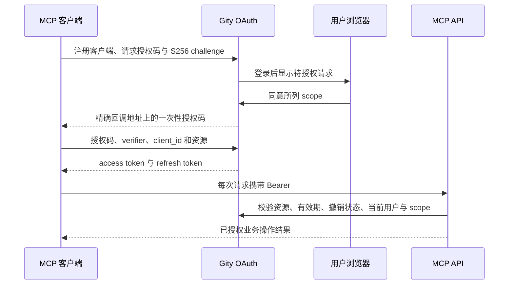

# 管理员与 MCP 授权

## 初始化管理员

服务从配置引导创建管理员，默认用户名为 `root`。普通注册创建普通用户；登录只认证已存在账号，不自动注册。

```toml
[bootstrap]
enabled = true
username = "root"
# email = "admin@example.com"
# initial_password_file = "/run/secrets/gity_root_password"
# generated_password_file = "/var/lib/gity/bootstrap/admin-password"
```

未指定 `initial_password_file` 时，服务使用密码学随机数生成初始密码，默认写入 `storage.root/bootstrap/admin-password`。Linux 下生成目录必须由当前用户持有、权限为 `0700`，文件为 `0600`；不接受符号链接或其他用户的生成文件。不要把密码放入 CLI、日志或镜像层。

数据库唯一初始化记录与管理员、密码和个人组织在同一事务内提交。只有取得初始化事务的进程读写密码文件。初始化后更改配置、重新启动、降权或删除该账号，均不会重新设置密码或自动补回管理员权限。生成的密码文件满 24 小时后，在后续启动时清理；账号密码不会因此过期。用户提供的输入密码文件不会被清理。

分布式部署由 API 进程执行管理员初始化；Git 和 Worker 角色不执行。数据库迁移仍须由单一任务执行。需要运维恢复时，对正确数据库运行 `set-password` 或 `grant-admin`；这些是显式管理操作。

## MCP OAuth

MCP 使用当前 Gity 用户身份和持久化 OAuth 授权，资源地址固定为对外 `http.base_url` 加 `/mcp`。

| 端点 | 用途 |
| --- | --- |
| `/.well-known/oauth-authorization-server` | 授权服务元数据 |
| `/.well-known/oauth-protected-resource/mcp` | MCP 资源元数据 |
| `/oauth/register` | 有数量上限的公开客户端注册 |
| `/oauth/authorize` | 验证请求后进入浏览器授权页面 |
| `/api/v1/oauth/requests/{request_id}` | 读取待授权请求或提交同意、拒绝 |
| `/oauth/token` | 表单编码的授权码兑换、刷新 |
| `/oauth/revoke` | 表单编码的令牌撤销 |

授权服务对外地址要求 HTTPS；本机回环地址可使用 HTTP，且地址不能包含路径前缀、查询或用户信息。公开客户端不使用客户端秘密，必须使用 PKCE `S256`。回调地址必须精确匹配已注册地址，允许 HTTPS 和本机回环 HTTP。资源地址也必须精确匹配。授权页面要求现有浏览器会话，显示客户端、scope 和目标资源，由用户明确同意或拒绝。



授权 scope 为 `mcp`、`read_api`、`write_api` 和可选的 `admin_mode`。工具查询要求 `read_api`，变更要求 `write_api`，两者都要求 `mcp`。管理员账号的普通授权不会自动继承超级管理员权限；`admin_mode` 授权还要求当前管理员重新输入密码，执行时重新检查账号状态和权限。该 scope 不替代项目或组织资源权限检查。

令牌绑定 `/mcp` 资源，不能用于 REST 或 GraphQL。REST 和 GraphQL 使用现有会话或个人令牌。数据库只保存 OAuth 授权码和令牌的摘要；授权码只能兑换一次，刷新令牌轮换，重放已消费的刷新令牌会撤销整组授权。撤销状态单独持久化，每次调用同时检查令牌与授权组，避免并发产生的后续令牌继续生效。客户端应串行刷新；主动撤销任一令牌也会撤销该组授权。重启不会丢失客户端或授权状态。

`[oauth]` 默认授权码有效期 600 秒、access token 3600 秒、refresh token 2592000 秒、待授权请求 300 秒，动态客户端最多 1000 个。可通过配置文件和 `GITY_OAUTH__...` 覆盖，启动时检查范围。代理外部地址、来源策略与 API 限制参见[多协议 API](api-transports.md)。
