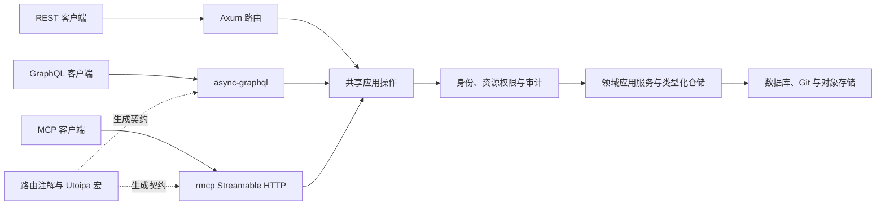

# REST、GraphQL 与 MCP

平台在相同的 HTTP 监听器上提供三种业务 API。Standalone 由 `PlatformModule` 组织启动；独立 API 进程使用同一组件。GraphQL 和 MCP 不连接另一套数据库，也不通过 HTTP 回调 REST 路由。



`gity-api-macros` 将现有业务入口拆为 REST 包装和共享操作。`gity-api-contracts` 定义请求上下文、操作契约和错误；平台注册实际业务操作，`gity-graphql` 和 `gity-mcp` 负责协议适配。FluxDI 在启动时装配这两种适配器，并在监听前检查契约。

## 能力边界

| 接口 | 用途 |
| --- | --- |
| `/api/v1/...` | REST 业务管理、登录、会话和协议入口 |
| `/api/graphql` | 具有独立命名字段、类型化输入输出的查询和变更 |
| `/mcp` | Streamable HTTP；`tools/list` 返回操作及输入输出契约，`tools/call` 执行应用用例 |
| Git HTTP/SSH、LFS、包协议、OCI | 原协议的流式传输、条件请求与客户端兼容性 |

GraphQL 和 MCP 管理项目、协作、仓库元数据、CI 和制品元数据。Git pack、LFS 对象、容器层、包上传下载、Runner 领取任务和登录换取会话保留专用入口。这些传输不是工具调用中的 Base64 大对象。

操作输入按 `path`、`query`、`body` 分组；ID 使用字符串。返回数组的操作另提供 `pagination.page` 和 `pagination.page_size`，默认第 1 页、每页 50 项，最多 100 项。此分页限制返回条数，底层已有应用服务的查询仍可能读取完整集合。

GraphQL 默认关闭 introspection，不提供 Playground。默认深度 12、复杂度 200、请求体 1 MiB。查询和变更分别出现在 `Query`、`Mutation` 中，错误扩展包含 `code` 和 `status`；服务端错误不返回内部细节。MCP 每个操作对应独立工具，结果统一包装为 `structuredContent.result`。

## 配置

以下配置可放入服务配置文件；环境变量使用 `GITY_API__...` 覆盖。配置优先级沿用代码默认值、配置文件、环境变量、显式 CLI 参数的顺序。

```toml
[api]
graphql_enabled = true
mcp_enabled = true
graphql_introspection = false
graphql_max_depth = 12
graphql_max_complexity = 200
max_request_bytes = 1048576
mcp_max_concurrent_requests = 64
mcp_request_timeout_seconds = 30
mcp_allowed_origins = []
mcp_allowed_hosts = []
```

空的 Origin、Host 列表从 `http.base_url` 派生。反向代理部署必须设置对外地址；需要其他浏览器来源时逐项配置精确 Origin。MCP 会在每个 HTTP 请求和工具执行时重新鉴权，不把会话标识作为权限凭据。OAuth 授权参见[管理员与授权](administration.md)。

## 开发文档与发布产物

Utoipa 宏保留在开发和离线契约生成流程中。只有显式启用 `api-docs` 的调试构建提供 Swagger UI 和 OpenAPI 端点：

```sh
cargo run -p gity-standalone --features api-docs
```

Release 构建禁止启用 `api-docs`。发布二进制和镜像不包含 Swagger UI 资源，`/docs`、`/docs/`、`/openapi.json` 及文档资源路径返回 404；SPA 回退不会把这些路径返回成首页。真实 Git LFS 路由独立注册，不受文档开关影响。
